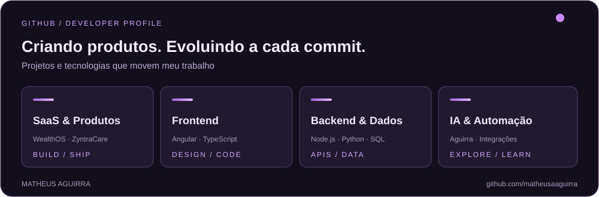

<!-- PROFILE README • Matheus Aguirra -->

 

---

### 👨‍💻 Sobre mim

Sou **Matheus Aguirra**, estudante de **Ciência da Computação**, desenvolvedor de software e criador de produtos digitais. Minha experiência em **TI e suporte técnico** reforça algo que levo para o desenvolvimento: entender o problema antes de escrever a solução.

Hoje, exploro a interseção entre **desenvolvimento web, produtos SaaS, automação e inteligência artificial**. Gosto de construir projetos completos — da interface à arquitetura, do banco de dados ao deploy.

- 📍 São Paulo, Brasil
- 🎓 Ciência da Computação
- 💼 Experiência com TI / Help Desk e desenvolvimento web
- 🚀 Criando soluções SaaS e experiências digitais
- 🧠 Estudando engenharia de software e fluxos de desenvolvimento com IA

### ✦ Projetos em destaque

<table>
<tr>
<td width="50%" valign="top">
  <h3>💠 <a href="https://github.com/matheusaaguirra/WealthOS">WealthOS</a></h3>
  
<strong>Finanças pessoais · SaaS</strong>

  
Aplicação de gestão financeira com contas, lançamentos, investimentos, gráficos e acompanhamento do patrimônio.

  
</td>
<td width="50%" valign="top">
  <h3>✳️ <a href="https://zyntracare.com">ZyntraCare</a></h3>
  
<strong>Gestão de clínicas · SaaS</strong>

  
Plataforma para organizar agenda, estoque, prontuários, processos financeiros e alertas operacionais.

  
</td>
</tr>
<tr>
<td width="50%" valign="top">
  <h3>🤖 Aguirra</h3>
  
<strong>Assistente pessoal · Inteligência Artificial</strong>

  
Projeto de assistente inteligente com comandos por voz, automações e integrações com aplicativos e dispositivos.

  
</td>
<td width="50%" valign="top">
  <h3>🎨 <a href="https://github.com/matheusaaguirra/Portfolio">Portfólio</a></h3>
  
<strong>Design & desenvolvimento web</strong>

  
Meu espaço digital: uma experiência responsiva e moderna para apresentar trabalhos, tecnologias e minha trajetória.

  
</td>
</tr>
</table>

[**Explorar todos os repositórios ↗**](https://github.com/matheusaaguirra?tab=repositories)

### 🛠️ Tecnologias & ferramentas

**Frontend**

**Backend & dados**

**Ferramentas & deploy**

### 📊 GitHub & atividade

 

[**Explorar repositórios ↗**](https://github.com/matheusaaguirra?tab=repositories) &nbsp; • &nbsp; [**Ver contribuições no GitHub ↗**](https://github.com/matheusaaguirra?tab=overview)

O painel é um SVG armazenado neste repositório. Os dados de atividade atualizados estão no perfil oficial do GitHub.

### 🤝 Vamos conversar?

Tenho interesse em **desenvolvimento de software, colaboração, produtos digitais e projetos desafiadores**.

 

Made with curiosity, purpose & code. © 2026 Matheus Aguirra

